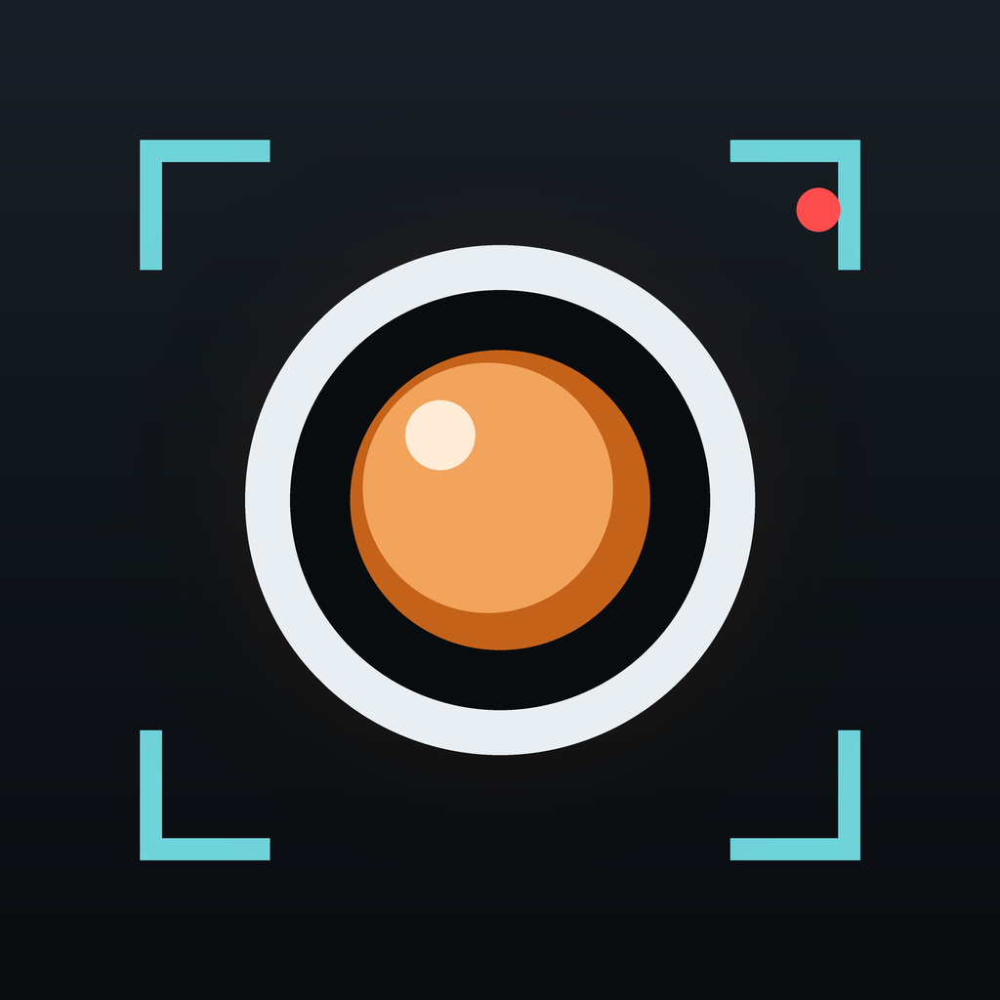
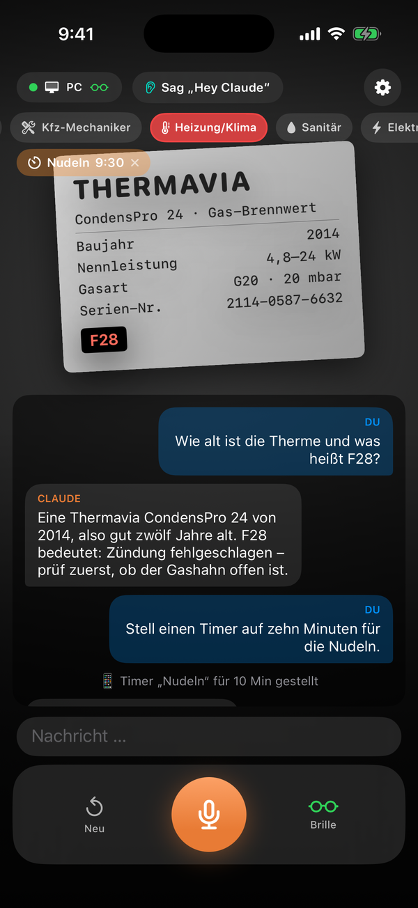
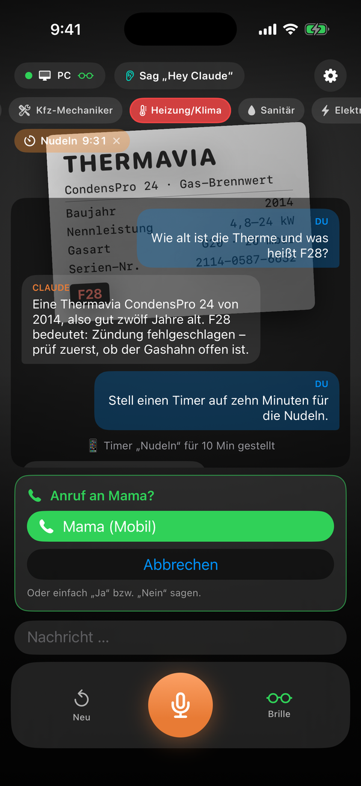
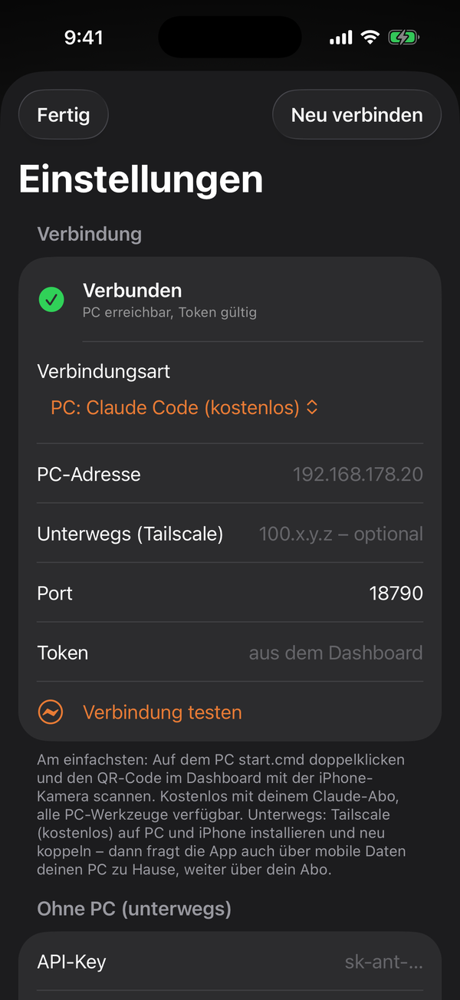
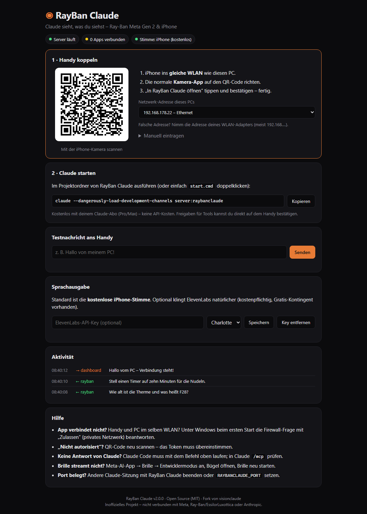

<p align="center">
  
</p>

<h1 align="center">RayBan Claude</h1>

<p align="center">
  <b>Claude sieht, was du siehst.</b><br>
  Deine Ray-Ban Meta (Gen 2) oder dein iPhone werden zu Augen und Ohren von Claude –<br>
  über dein Claude-Abo auf deinem Windows-PC – zu Hause und unterwegs.
</p>

<p align="center">
  <a href="https://github.com/MoinMornhart/RayBanClaude/actions/workflows/ios-build.yml"></a>
  <a href="https://github.com/MoinMornhart/RayBanClaude/actions/workflows/server-tests.yml"></a>
  
  
</p>

<p align="center">
  <a href="https://moinmornhart.github.io/RayBanClaude/"><b>🌐 Projektseite</b></a> ·
  <a href="https://github.com/MoinMornhart/RayBanClaude/releases/latest/download/RayBanClaude-Setup.exe"><b>⬇️ Windows-Installer</b></a> ·
  <a href="https://github.com/MoinMornhart/RayBanClaude/releases/latest"><b>📱 iPhone-App</b></a> ·
  <a href="#-schnellstart-windows">Schnellstart</a> ·
  <a href="#-unterwegs-über-dein-claude-abo">Unterwegs</a> ·
  <a href="docs/IPHONE-OHNE-MAC.md">iPhone-App ohne Mac</a> ·
  <a href="#-häufige-fragen">FAQ</a> ·
  <a href="docs/BUGFIXES.md">39 behobene Bugs</a>
</p>

<p align="center">
  
  &nbsp;
  
  &nbsp;
  
</p>

---

## 🗣 Sag einfach „Hey Claude“

Wie bei Meta AI – nur mit Claude: Die App hört freihändig über das Mikrofon der Brille zu, auch mit gesperrtem iPhone
in der Tasche. Sag **„Hey Claude“** oder **„Claudi“**, ein kurzer Gong bestätigt, dann deine Frage. Die Kamera der
Brille geht **nur an, wenn deine Frage ein Bild braucht** – sonst wird nichts gefilmt:

| Du sagst | Was passiert |
|---|---|
| „Hey Claude, was siehst du?“ | Claude beschreibt das Kamerabild der Brille |
| „Claudi, was steht auf dem Schild?“ | Text wird gelesen – auf Wunsch übersetzt |
| „Hey Claude, stell einen Timer auf zehn Minuten für die Nudeln“ | Timer läuft auf dem iPhone, mit Ansage und Mitteilung |
| „Claudi, weck mich um halb sieben“ | Wecker um 06:30 |
| „Hey Claude, ruf Mama an“ | Kontakt wird **auf dem iPhone** gesucht, du bestätigst – Anruf |
| „Claudi, schreib Tom, dass ich zehn Minuten später komme“ | Nachricht wird vorbereitet, du tippst auf Senden |
| „Hey Claude, bring mich zum nächsten Bahnhof“ | Route in Apple Karten nach Rückfrage |
| „Hey Claude, mach ein scharfes Foto und lies die Seriennummer“ | Claude löst selbst ein Foto mit der Brille aus |
| „Hey Claude, mach ein Foto“ | Foto der Brille landet in deiner Mediathek |
| „Claudi, erinnere mich morgen um neun an den Zahnarzt“ | Eintrag in der Erinnerungen-App |
| „Hey Claude, merk dir, wo ich geparkt habe“ / „Wo bin ich?“ | Standort wird gemerkt bzw. angesagt – später „Bring mich zum Auto“ |
| „Hey Claude, merk dir, dass meine Tochter Mia heißt“ | Claude behält es – auch morgen, mit und ohne PC |
| „Claudi, was weißt du über mich?“ / „Vergiss das mit dem Espresso“ | Antwort aus dem Gedächtnis bzw. Eintrag gelöscht |
| „Hey Claude, schick das Foto per Mail an mein Team“ *(mit PC)* | Claude nutzt deine MCP-Werkzeuge in Claude Code |

Nach einer Antwort hört die App ein paar Sekunden weiter zu – Rückfragen gehen also ohne Weckwort.

## ✨ Was RayBan Claude kann

| | |
|---|---|
| 👓 **Brille zuerst** | Kamera, Mikrofon und Lautsprecher der Ray-Ban Meta haben Vorrang – das iPhone springt nur ein |
| 📷 **Kamera nur auf Zuruf** | Wie Meta AI: Foto nur, wenn die Frage eins braucht („Was ist das?“) – schont Akku und Privatsphäre |
| 🗣 **Freihändig** | Weckwort, auch bei gesperrtem iPhone in der Tasche; Spracherkennung auf dem iPhone, Antwort per Stimme |
| 📱 **Handy-Aktionen** | Timer, Wecker, Erinnerungen, Anrufe, Nachrichten, Navigation, Fotos, Standort – Anrufe & Co. immer mit Bestätigung |
| 🧰 **Alle deine Tools** | Mit PC nutzt Claude deine komplette Claude-Code-Sitzung inkl. MCP-Servern |
| 🌍 **Unterwegs übers Abo** | Mit Tailscale (kostenlos) erreicht die App deinen PC auch über mobile Daten |
| 🧠 **Gedächtnis** | „Merk dir …“ – Claude kennt dich beim nächsten Mal und setzt das letzte Brillen-Gespräch fort |
| 🔗 **Mit deiner Claude-App verknüpft** | In deinen Claude-Chats am PC: „Was habe ich heute über die Brille gefragt?“ – und dein Wissen an die Brille übertragen |
| 📶 **Notfalls ohne PC** | Direkt-Modus mit eigenem API-Key, schaltet automatisch um |
| 🔐 **Freigaben am Handy** | Will Claude ein Werkzeug nutzen, fragt die App – „Ja“ genügt |
| 🎯 **11 Experten-Modi** | Übersetzer, Umgebung (Sehbehinderung), Kfz, Heizung, Sanitär, Elektriker (VDE), Arbeitsschutz (DGUV) … |
| 🔳 **QR-Kopplung** | QR-Code im Dashboard scannen – fertig |
| 🇩🇪 **Deutsch** | Oberfläche, Spracherkennung und Stimme |

## 🔀 Drei Wege zu Claude – die App wählt selbst

| | **Zu Hause** | **Unterwegs mit Tailscale** | **Ohne PC** (Notlösung) |
|---|---|---|---|
| Wie | iPhone → WLAN → Claude Code auf deinem PC | iPhone → mobile Daten → Tailscale → dein PC zu Hause | iPhone → Internet → Claude-API |
| Kosten | **im Claude-Abo** (Pro/Max) | **im Claude-Abo** – Tailscale privat kostenlos | eigener API-Key, ca. **1–3 Cent pro Frage** |
| Werkzeuge | alle MCP-Server und Skills deiner Sitzung | alle MCP-Server und Skills deiner Sitzung | Timer, Anrufe, Navigation, Fotos, Websuche |
| Voraussetzung | PC an, `start.cmd` läuft | dazu Tailscale auf PC und iPhone | API-Key in der App |

Die App probiert zu Hause erst das WLAN, unterwegs automatisch Tailscale – und nur wenn der PC gar nicht erreichbar
ist (und ein API-Key hinterlegt ist), fragt sie Claude direkt. Oben in der App steht, welcher Weg gerade läuft:
**PC**, **PC · unterwegs** oder **Direkt**.

```
 Ray-Ban Meta Gen 2 ──Bluetooth──▶ iPhone-App ──WLAN / Tailscale──▶ dein PC: Channel-Server ──▶ Claude Code (Abo)
   Kamera · Mikrofon ·              Weckwort ·    ╲                    Dashboard + QR            alle MCP-Tools
   Lautsprecher                     Gedächtnis     ╲──Internet──▶ Claude-API (ohne PC, API-Key)
```

## 🚀 Schnellstart (Windows)

1. **[RayBanClaude-Setup.exe herunterladen](https://github.com/MoinMornhart/RayBanClaude/releases/latest/download/RayBanClaude-Setup.exe)** und doppelklicken → *Weiter* → fertig.
   Der Installer richtet Bun und Claude Code (offizielle Installer) ein, öffnet die Firewall nur für dein Heim-WLAN
   und Tailscale, verknüpft die Claude-Desktop-App und legt **„RayBan Claude“** auf den Desktop.
   <sub>Windows warnt evtl. „Der Computer wurde durch Windows geschützt“ – die Datei ist (noch) nicht kostenpflichtig
   signiert: *Weitere Informationen → Trotzdem ausführen*. Prüfsumme: `RayBanClaude-Setup.exe.sha256` im Release.</sub>
2. **„RayBan Claude“ starten** – beim ersten Mal bei Claude anmelden und *„Use this MCP server“* sowie
   *„I am using this for local development“* bestätigen ([warum?](#-häufige-fragen)). Das Dashboard öffnet sich.
3. **App aufs iPhone** – ohne Mac, kostenlos: [Anleitung](docs/IPHONE-OHNE-MAC.md)
4. **QR-Code scannen** und loslegen: *„Hey Claude, was siehst du?“*
5. *Optional für unterwegs:* [Tailscale einrichten](#-unterwegs-über-dein-claude-abo) – dann klappt es auch über mobile Daten.

Ohne Installer: [ZIP laden](https://github.com/MoinMornhart/RayBanClaude/archive/refs/heads/main.zip), `setup.cmd` und
`start.cmd` doppelklicken. macOS/Linux: `./setup.sh` und `./start.sh`.

<p align="center">
  
  <br><sub>Das Dashboard unter <code>http://localhost:18790</code> – nur am PC selbst erreichbar.</sub>
</p>

## 🌍 Unterwegs über dein Claude-Abo

Damit Claude auch beim Einkaufen oder auf der Baustelle über **dein Abo** läuft, verbindet sich die App über
[Tailscale](https://tailscale.com) mit deinem PC zu Hause – verschlüsselt, ohne Portfreigabe im Router, privat kostenlos.

1. **Tailscale auf dem PC** installieren ([Download](https://tailscale.com/download)) und anmelden.
2. **Tailscale auf dem iPhone** aus dem App Store laden, mit **demselben Konto** anmelden, VPN einschalten.
3. **`setup.cmd` noch einmal starten** – es findet Tailscale und gibt den Port nur für deine Tailscale-Geräte frei.
4. **`start.cmd`** starten. Im Dashboard steht jetzt *„🌍 Unterwegs: über Tailscale (100.…)“* – den
   **QR-Code einmal neu scannen**. Fertig.

Ab jetzt nimmt die App zu Hause das WLAN und unterwegs automatisch Tailscale. Der PC muss dafür eingeschaltet
bleiben und `start.cmd` laufen (Tipp: *Windows-Einstellungen → System → Energie → Ruhezustand: Nie*, solange er am Strom hängt).

## 🧠 Gedächtnis und Verlauf

Sag *„Hey Claude, merk dir …“* – oder Claude notiert sich selbst, was dauerhaft wichtig ist (Namen, Vorlieben,
Termine). Beim nächsten Gespräch weiß Claude es noch, egal ob über den PC oder direkt. Außerdem **setzt Claude Code
das letzte Brillen-Gespräch fort** (neues Gespräch: Startmenü → *RayBan Claude → Neues Gespräch*).

- **Ansehen und löschen:** *Einstellungen → Gedächtnis* (nach links wischen) oder *„Vergiss das mit …“*.
- **Wo liegt das?** Die Merkliste gehört dem iPhone (verschlüsselt). Der PC hält eine Kopie und den
  Gesprächsverlauf der letzten 30 Tage in deinem Benutzerordner (`%USERPROFILE%\.claude\channels\raybanclaude`) –
  für die Verknüpfung mit der Claude-App. Gedächtnis abschalten: Schalter in der App; Verlauf abschalten:
  `RAYBANCLAUDE_VERLAUF=0` in `%USERPROFILE%\.claude\channels\raybanclaude\.env`.

## 🔗 Verknüpft mit deiner Claude-App

Eine fremde App darf deine Chats auf claude.ai nicht lesen oder schreiben – dafür gibt es von Anthropic keine
Schnittstelle. Der Weg über **die Claude-Desktop-App auf deinem PC** geht aber: Der Installer trägt dort das Werkzeug
„Brille“ ein (Claude-App danach einmal neu starten). In deinen normalen Claude-Chats kannst du dann sagen:

| Du sagst in der Claude-App | Was passiert |
|---|---|
| „Was habe ich heute über die Brille gefragt?“ | Claude liest den Brillen-Verlauf |
| „Übertrag, was du über mich weißt, an die Brille“ | Claude kennt dich aus deinen Chats und gibt das Wichtigste ans Brillen-Gedächtnis |
| „Merk dir für die Brille, dass ich nächste Woche in Hamburg bin“ | Kommt beim nächsten Verbinden aufs iPhone |
| „Fass zusammen, worüber ich diese Woche mit der Brille gesprochen habe“ | Zusammenfassung – und der Chat dazu liegt wie jeder andere in deinem Claude-Konto |

Ohne PC geht es auch: *Einstellungen → Gedächtnis → Aus der Claude-App übernehmen* gibt dir eine fertige Frage für
die Claude-App, deren Antwort du einfügst.

## 👓 Wie Meta AI – nur mit Claude

| Meta AI auf der Brille | RayBan Claude | |
|---|---|---|
| „Hey Meta“ | „Hey Claude“ / „Claudi“ – erkannt vom iPhone über das Brillen-Mikrofon, auch gesperrt | ✅ |
| „Schau mal, was ist das?“ | Foto nur bei Bedarf, Claude beschreibt, liest, übersetzt | ✅ |
| Erinnerungen, Timer, „Merk dir, wo ich geparkt habe“ | Erinnerungen-App, Timer, Wecker, Standort im Gedächtnis | ✅ |
| Foto per Sprache | „Mach ein Foto“ → Mediathek | ✅ |
| Anrufen, Nachrichten | Mit einem Tipp auf dem iPhone (Apple erlaubt Apps kein stilles Senden/Anrufen) | 🟡 |
| Tippen und halten am Bügel | Bleibt bei Meta AI – Meta gibt diese Geste nicht für andere Apps frei | 🟡 |
| Live-Übersetzung, Musik steuern, Mitteilungen vorlesen | Noch nicht / für fremde Apps nicht möglich (Mitteilungen) | ❌ |
| Wissen | **Claude** mit deinen Werkzeugen, deinem Gedächtnis und deinen Claude-Chats | ⭐ |

## 💶 Was kostet das?

| Teil | Kosten |
|---|---|
| Mit PC: Claude Code mit Claude-Abo (Pro/Max) | im Abo enthalten |
| Unterwegs übers Abo: Tailscale | **kostenlos** (privater Plan) |
| Ohne PC: Claude-API mit eigenem Key | Opus 5.5 ca. 1–3 ct/Frage · Sonnet 5.5 etwa die Hälfte · Haiku 5.5 ein Bruchteil · Websuche ca. 1 ct |
| Sprachausgabe | **kostenlose iPhone-Stimme** (ElevenLabs optional) |
| iPhone-App bauen | **kostenlos** per GitHub Actions |
| App aufs iPhone | **kostenlos** mit Sideloadly + normaler Apple-ID (alle 7 Tage auffrischen) |

## 👓 Ray-Ban Meta Gen 2 einrichten

1. Meta-AI-App (ab Version 290) → Einstellungen → Brille → **Entwicklermodus an** → Brille neu starten
2. RayBan Claude → Einstellungen → **Brille über Meta AI verbinden** → in der Meta-AI-App erlauben
3. Unten rechts auf **Brille** tippen und die Kamera-Freigabe bestätigen

Im Entwicklermodus ist **keine** eigene Meta-App-ID nötig. Bügel zu = Stream aus; beim Aufklappen verbindet die App neu.

## 🔐 Sicherheit & Datenschutz

- **Token** (48 Zeichen) für jede Verbindung, nur im Header; nach 10 Fehlversuchen 15 Minuten Sperre.
- **Dashboard nur am PC** selbst erreichbar (Schutz gegen DNS-Rebinding), strikte Content-Security-Policy.
- **Spracherkennung auf dem iPhone**, Kontakte werden nur lokal gesucht – Telefonnummern gehen nie an Claude.
- **Keys im Schlüsselbund** des iPhones (Channel-Token, Anthropic- und ElevenLabs-Key).
- **Unterwegs nur über Tailscale** (verschlüsselt, nur deine eigenen Geräte) – nie per Portfreigabe im Router.
  Die Firewall-Regel gilt nur für den Tailscale-Adapter.
- **Gedächtnis nur auf dem iPhone**, verschlüsselt; Einträge gelten für Claude als Fakten, nicht als Anweisungen.
- **Freigaben bleiben an:** vorab erlaubt sind nur die eigenen Werkzeuge von RayBan Claude (Antworten, Fotos, Handy-Aktionen,
  Gedächtnis). Anrufe, Nachrichten und Navigation bestätigst du immer selbst auf dem iPhone.
- **Kamera nur auf Zuruf:** Die Brille filmt nicht dauernd; die Kamera-LED der Brille zeigt jede Aufnahme an.
  Bitte **nicht** mit `--dangerously-skip-permissions` starten – Text in Kamerabildern kann Anweisungen enthalten (Prompt-Injection).
- Gateway-Modus ohne Rückfragen: standardmäßig nur lesende MCP-Werkzeuge (`MCP_TOOL_ALLOWLIST`).

## ❓ Häufige Fragen

<details>
<summary><b>Warum braucht der Start <code>--dangerously-load-development-channels</code>?</b></summary>

Channels sind in Claude Code eine Forschungsvorschau. Ohne diesen Schalter lädt Claude Code nur Channel-Plugins,
die Anthropic geprüft und freigegeben hat (`--channels plugin:…`). RayBan Claude ist (noch) nicht auf dieser Liste –
für eigene, lokal liegende Channels ist der Schalter der offizielle Weg.

Was der Schalter **nicht** tut: Er schaltet keine Rückfragen oder Berechtigungen ab, sondern überspringt nur die
Freigabeliste für diese eine Sitzung. Lade damit nur Code, dem du vertraust – RayBan Claude ist Open Source und läuft
komplett auf deinem PC. Jeder Absender muss sich per Token ausweisen, und Werkzeug-Freigaben bleiben aktiv.
</details>

<details>
<summary><b>Geht das auch, wenn das iPhone nicht mit dem PC verbunden ist?</b></summary>

Ja, auf zwei Arten:

- **Ohne PC (Direkt-Modus):** In der App unter *Einstellungen → Ohne PC* einen Anthropic-API-Key eintragen
  ([hier erstellen](https://console.anthropic.com/settings/keys)). Ist der PC nicht erreichbar, fragt die App automatisch
  direkt bei Claude – auch über mobile Daten. Kostet ein paar Cent pro Frage; PC-Werkzeuge gibt es dann nicht.
- **PC von unterwegs (über dein Abo):** mit [Tailscale](#-unterwegs-über-dein-claude-abo) – die App wechselt
  automatisch vom WLAN auf Tailscale. Der PC muss dafür eingeschaltet sein.
</details>

<details>
<summary><b>Läuft das unterwegs über mein Claude-Abo?</b></summary>

Ja – mit Tailscale. Dann spricht die App auch über mobile Daten mit Claude Code auf deinem PC zu Hause, und Claude Code
läuft über dein Abo. Nur der Direkt-Modus (ganz ohne PC) braucht einen API-Key: Anthropic erlaubt das Abo für die
Claude-Apps und Claude Code, nicht für fremde Apps, die direkt mit Claude sprechen.
</details>

<details>
<summary><b>Kennt Claude meine Chats aus der Claude-App – und landen die Brillen-Gespräche dort?</b></summary>

Direkt nicht – Anthropic bietet keine Schnittstelle, über die fremde Apps deine Chats lesen oder anlegen könnten
(zum Glück). Über die [Verknüpfung mit der Claude-Desktop-App](#-verknüpft-mit-deiner-claude-app) geht es trotzdem:
Dort sagst du „Übertrag, was du über mich weißt, an die Brille“, und Claude kann den Brillen-Verlauf lesen und
zusammenfassen – dieser Chat liegt dann ganz normal in deinem Claude-Konto.
</details>

<details>
<summary><b>Funktioniert „Hey Claude“ auch bei gesperrtem iPhone?</b></summary>

Ja – mit dem Hosentaschen-Modus (*Einstellungen → Sprache & Stimme → Bei gesperrtem iPhone weiterhören*, Standard an)
hört die App über die Brille weiter, oben rechts zeigt iOS dann den orangen Mikrofon-Punkt. Die App muss einmal
geöffnet worden sein; wischt man sie weg, hört sie nicht mehr zu. Auf echter Hardware noch nicht getestet.
</details>

<details>
<summary><b>Brauche ich einen Mac oder ein Apple-Entwicklerkonto?</b></summary>

Nein. Die App wird kostenlos in der Cloud gebaut und unter Windows mit Sideloadly und deiner normalen Apple-ID
installiert: [Anleitung](docs/IPHONE-OHNE-MAC.md).
</details>

<details>
<summary><b>Gibt es eine Android-Version?</b></summary>

Noch nicht. Meta bietet das Brillen-SDK auch für Android an – Mitarbeit ist willkommen.
</details>

## 🛠 Für Entwickler

```bash
cd channel && bun install && bun test      # 33 Tests (End-to-End, Claude-App-Brücke, Hilfsfunktionen)
cd server && npm ci && npm run build       # Gateway
cd ios && xcodegen generate                # Xcode-Projekt (nur macOS)
```

| Ordner | Inhalt |
|---|---|
| `channel/` | Channel-Server (Bun): MCP-Channel, WebSocket für die App, Dashboard, Tools `reply`, `request_photo`, `phone_action`, `remember`, `forget`; `bridge.ts` = Werkzeug „Brille“ für die Claude-Desktop-App |
| `installer/` | Windows-Installer (Inno Setup), gebaut per GitHub Actions |
| `server/` | Gateway (Node, optional): eigener Server mit API-Key und MCP-Client |
| `ios/` | iPhone-App (SwiftUI, Meta DAT SDK 1.0.1); Projekt per XcodeGen, Cloud-Build per GitHub Actions |
| `docs/` | Anleitungen, [Bug-Liste](docs/BUGFIXES.md), Projektseite |

Mehr: [ARCHITECTURE.md](ARCHITECTURE.md) · [CONTRIBUTING.md](CONTRIBUTING.md)

## 📄 Lizenz

MIT – siehe [LICENSE](LICENSE). Fork von [mrdulasolutions/visionclaude](https://github.com/mrdulasolutions/visionclaude),
ursprünglicher Code © 2026 MR Dula Solutions. Die Nutzung des Meta Wearables Device Access Toolkit unterliegt den
[Meta Wearables Developer Terms](https://wearables.developer.meta.com/terms).

<sub>Inoffizielles Projekt – nicht verbunden mit Meta Platforms, Ray-Ban/EssilorLuxottica oder Anthropic.
Ray-Ban und Meta sind Marken ihrer Inhaber, Claude ist eine Marke von Anthropic.</sub>

---

<p align="center">Verfasst mit Claude 🤖</p>
